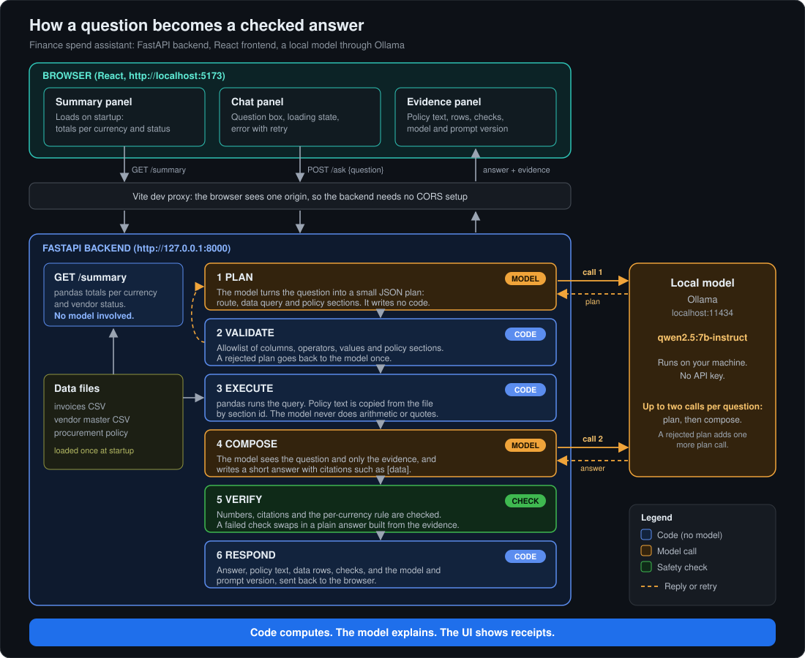

# Finance spend assistant

A small web app where a finance analyst asks questions about vendor invoices and a procurement policy excerpt, and gets an answer together with the evidence it is based on. FastAPI backend, React frontend, a local model through Ollama.

The idea: **code computes, the model explains, the UI shows receipts.** The model never does arithmetic and never writes quotes. Numbers come from pandas, policy text is copied from the policy file, and every answer is checked against its evidence before it is shown.

## Which LLM path I took

A local model through **Ollama**: `qwen2.5:7b-instruct` (about 4.7 GB). No API key and no stub in the app. The fake model used by the tests lives in `backend/tests/` only. Every response reports the model and the prompt version that produced it.

## Quick start

You need Python 3 (tested with 3.12.12), Node (tested with v26.13.0; Vite 8 needs 20.19 or 22.12 and up) and [Ollama](https://ollama.com) running.

```
ollama pull qwen2.5:7b-instruct
```

Terminal 1, the backend (run it from `backend/`, because the module is `app.main`):

```
cd backend
python3 -m venv .venv
source .venv/bin/activate
pip install -r requirements.txt
uvicorn app.main:app --port 8000 --reload
```

Terminal 2, the frontend:

```
cd frontend
npm ci
npm run dev
```

Open **http://localhost:5173**. Vite listens on `localhost`, so if `127.0.0.1` does not work, use `localhost`. The dev server forwards `/summary` and `/ask` to the backend on port 8000, so the backend needs no CORS setup.

- **Speed.** Answers take a few seconds, up to about 15 s for longer questions. The first question after a pause can take 30 to 40 s while Ollama loads the model.
- **Settings.** Optional. A `.env` file at the repository root, or real environment variables (which win over the file): `OLLAMA_MODEL=qwen2.5:7b-instruct` and `OLLAMA_HOST=http://localhost:11434`.
- **Tests.** `cd backend && python -m pytest`. 36 tests, a few seconds, no Ollama needed. Pytest prints one warning from Starlette: `Using httpx with starlette.testclient is deprecated; install httpx2 instead`. I left it. Replacing the dependency late adds more risk than the warning costs.
- **Checked from a fresh clone:** the backend install and the 36 tests, and the frontend `npm ci` and `npm run build`. The full app against Ollama was run from my working copy.

## How it works



1. **Plan:** the model turns the question into a small JSON plan (a route, a data query, policy section ids). It writes no code. *Model call 1.*
2. **Validate:** code checks the plan against an allowlist of columns, operators, values and policy sections. A rejected plan goes back to the model once.
3. **Execute:** pandas runs the query on the CSV data, and the policy text is copied from the file by section id.
4. **Compose:** the model sees the question and only the evidence, and writes a short answer with citations. *Model call 2.*
5. **Verify:** numbers, citations and the per-currency rule are checked. A failed check swaps in a plain answer built from the evidence (the fallback).
6. **Respond:** the answer, the evidence, the checks and the model and prompt version go back to the browser.

`GET /summary` is plain pandas, with no model involved.

**The API**
- `GET /summary`: invoice count, spend per currency, spend per currency and vendor status, and how many invoices have no PO number or no approver.
- `POST /ask` with `{"question": "..."}` returns `answer`, `declined`, `route` (data, policy, both or out_of_scope), `evidence` (policy sections with their exact text, and the data rows with how they were computed), `checks` and `meta` (backend, model, prompt version, stub flag, `fallback_used`). An empty or over-long question (more than 500 characters) is a 422. A model that is not running is a 503 with a clear message.

**Rules the code enforces**
- **Amounts in different currencies are never added together.** Policy 5.1 converts at the ECB rate on the invoice date, and I do not have those rates, so totals are per currency and a "top 5" is a top 5 per currency (up to 15 rows). Totals are net of credit notes.
- **A missing PO number or approver is a real value.** It is counted, grouped and shown as "missing", never dropped.
- **The model's plan is data, not code.** It is checked against an allowlist before pandas runs anything. Nothing the model writes is executed.
- **When it cannot answer, it says so.** Out-of-scope questions, plans that stay invalid after one retry, and queries that match no invoices are declined with a reason. For example, policy 7 (who requested a purchase) cannot be checked because the data has no requester field.
- **Text from data fields is untrusted.** The UI shows it as plain text, and the prompts tell the model that evidence is data, not instructions.

## Write-up

### 1. What I built and what I left out

I built the whole path from a question to a checked answer with its evidence: the six steps above, a summary panel, a chat panel and an evidence panel. I put my time into grounding and failure handling, not polish: a verifier with four checks, a fallback answer, declines, and tests that I proved fail when the code is broken (12 deliberate breaks, all caught).

Left out, and why: auth, deployment, CI/CD and Docker (the brief says not to); a vector database (the policy is about 50 lines and fits in context); streaming, chat history, a cancel button and polish (not needed to show the design); a currency rate table (I have no ECB rates, and invented ones would give numbers I could not defend); the eval set (not built yet).

### 2. How I would evaluate it

- **A question set with answers computed independently in pandas:** about 40 data, policy, both and should-decline questions, plus adversarial ones (instructions hidden in the question or in a data field).
- **Score:** route accuracy, whether the executed result equals the true result (not text matching), section recall, decline precision and recall, the verification pass rate and fallback rate, and latency (median and 95th percentile).
- **Hallucinations:** the verifier already rejects invented numbers, numbers from the wrong source and missing citations. It cannot see a wrong answer built from true numbers. I hit one during the build (a "top 5" that dropped a vendor), so I would review a sample of verified answers by hand and track "verified but wrong" as its own metric.
- **A tuning set kept apart from a test set,** rerun on every prompt or model change. I tuned on a few questions, so this repo has no accuracy number.

### 3. What production would need

- **200 users:** one local model serves one request at a time, and each question needs two calls. Use a hosted model or a GPU service behind a queue, with caching, rate limits and latency monitoring.
- **Real data:** a database, not CSV files loaded at startup, and ECB rates by invoice date (policy 5.1), so totals and the EUR approval tiers (policy 3) work for GBP and USD. Many policies would need retrieval.
- **Audit trail (policy 8.2):** log per question the user, time, question, plan, executed query, evidence rows or a data snapshot id, answer, checks, and the model, prompt and code versions. Append-only, kept 10 years (policy 8.1).
- **Access control:** single sign-on, roles and row-level limits (by cost center or entity), so the evidence only shows permitted rows. Agree what data may go to an external model.
- **Cost:** two calls per question. Use a small model for planning, cache repeats, set token budgets and alerts.
- **Safety:** with real data, instructions inside description fields become a real risk. Keep validated plans and the verifier, and gate releases on the question set in CI.

## What is tested, and what is not

**Tested (36 backend tests, run without Ollama, using a fake model):** summary totals against a hand calculation, the query executor, plan validation, each verifier check, the fallback, the pipeline (a verified answer, an invented number replaced by the fallback, a rejected plan retried once, declines), the `/ask` contract, 422 and 503, startup failing without data, and the `.env` reader. Eight headline tests are listed in `docs/DECISIONS.md`.

**Checked by hand, not automated:** the real model on about 16 questions (read against the data), the frontend build, the evidence panel rendered on the server with hostile sample text, and the screens in a browser.

**Not tested:** answer accuracy as a number (no eval set yet), automated frontend tests, phone-width layout and other browsers, many users at once, and prompt-injection attempts beyond a single manual try.

**Known limits**
- The short answer can mislead even when every number in it is real. The verifier checks numbers and citations, not meaning.
- A number can be used for the wrong claim inside one source. Numbers written as words, or rounded ("1.5 million"), are not recognised.
- Vendor names, descriptions and cost centers in a filter are not checked against known values. A misspelt vendor returns no rows, and the app says nothing matched.
- The policy approval table is shown as the text of the file, not as a rendered table.
- `approved_by` not equal to a name also counts invoices with no approver.
- The backend is read once at startup, so a changed data file needs a restart.

## Time and next steps

About 5.5 to 6 hours in total, by my own estimate from working time and notes. That is over the 3 to 4 hour box. The backend took the longest, mainly the plan step (getting a 7B model to produce reliable plans) and the query executor. Learning FastAPI and React while building is part of that time.

Next, in order: the eval set and scoring script, replacing the `httpx` test dependency (the warning above), real ECB rates, a cancel button, frontend tests, and phone and cross-browser checks.

## How AI was used

I built this with Claude Code in VS Code, in small reviewed steps. I set the architecture and the rules in `CLAUDE.md`, made the design decisions, reviewed each piece, tested the screens and made the commits. The assistant wrote most of the code and explained each piece. The log records what was generated, what I changed or rejected, and what went wrong.

- `CLAUDE.md`: the working agreement and the architecture. I wrote the final draft, refined with Claude from a preflight conversation, before any code.
- `docs/AI_USAGE.md`: what was asked, what was generated, what was changed or got wrong, and what was verified, for each milestone.
- `docs/DECISIONS.md`: the decisions and the alternatives I considered.
- `docs/PROMPTS.md`: the key prompts to the assistant (task, persona, expectations), and the prompts the app sends to the model.
- `backend/prompts/`: the prompts the app sends to the model, as versioned files (`plan_v1` to `plan_v3`, `compose_v1` and `compose_v2`). The versions in use are `plan_v3` and `compose_v2`.

## Project layout

```
backend/app/       data.py, plan.py, validate.py, execute.py, verify.py, fallback.py,
                   render.py, llm.py, pipeline.py, policy.py, settings.py, schemas.py, main.py
backend/prompts/   the prompts sent to the model
backend/tests/     36 tests and a fake model (tests only)
frontend/src/      api.js and the Summary, Chat and Evidence components
data/              the invoices, vendor master and policy excerpt
docs/              AI_USAGE.md, DECISIONS.md, PROMPTS.md, architecture.svg (the diagram)
```
